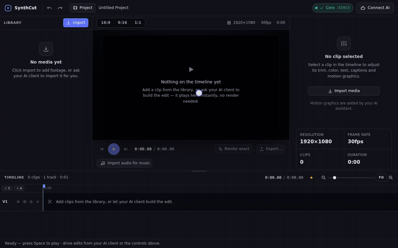

<div align="center">


<h1>ZabsReel</h1>

<h3>An open-source video editor built to be operated by&nbsp;<em>AI,&nbsp;not&nbsp;humans</em></h3>

<p>
A full multi-track, frame-based editor that exposes itself as an <b>MCP server</b> —<br/>
any MCP-compatible AI client drives real, local FFmpeg edits, fully offline.
</p>

<p>
<a href="LICENSE"></a>


</p>

</div>

> ZabsReel is a modified version of [SynthCut](https://github.com/Relo-video/SynthCut) by Relo, used under the GNU General Public License v3.0 or later. ZabsReel is an independent project. It is not affiliated with, sponsored by or endorsed by Relo. The name "SynthCut" is used here only to identify the original work.

<div align="center">
  <a href="docs/media/demo.mp4"></a>
</div>

---

Every video editor today — Premiere, DaVinci Resolve, CapCut — is designed for a person to click and drag. AI models can understand a user's creative intent perfectly, but they can't *operate* those tools. This project flips that: the AI is the primary operator. You describe the edit in plain language, the AI does it, you review and course-correct.

The editor exposes itself as an **MCP (Model Context Protocol) server**, so any MCP-compatible client — Claude Desktop or others — connects and drives it directly. All processing is **local and offline** via FFmpeg. Your footage never leaves your machine.

> **Status:** Stable. A full multi-track, frame-based editor with **85 MCP tools** — from import/cut/trim to per-clip transforms + keyframe animation, color grading, an effects stack, Whisper captions, subject-aware auto-reframe, motion graphics, media intelligence (transcript + semantic visual search), and platform export presets.

## Download & install (Windows)

Installers for this fork go on its [**Releases**](https://github.com/azabonik/ZabsReel/releases) page. **No installer has been published from this fork yet.** For now, the way in is to [build from source](#build-from-source), or to [run it in your browser](#run-in-your-browser).

Once a release is out:

1. Open the [**Releases**](https://github.com/azabonik/ZabsReel/releases) page and grab the latest build.
2. Download **one** of:
   - **`ZabsReel-<version>.exe`** — installer (adds a Desktop + Start‑menu shortcut), or
   - **`ZabsReel-<version>.zip`** — portable: unzip anywhere and run `ZabsReel.exe` (no install).
3. **Windows SmartScreen** may show *"Windows protected your PC."* This app is open‑source and **not code‑signed** (trusted certificates cost money). It is safe — click **More info → Run anyway**.

Everything (FFmpeg, Whisper, etc.) is bundled, so it runs fully offline. To drive it with AI, connect an MCP client (e.g. Claude Desktop) — see the **Connect AI** button in the app.

### Verify your download (optional but recommended)

Each release includes `SHA256SUMS.txt`. Confirm your file is intact — in PowerShell:

```powershell
Get-FileHash ".\ZabsReel-<version>.exe" -Algorithm SHA256
```

Compare the hash to the matching line in `SHA256SUMS.txt`. (This is the no‑cost stand‑in for a code signature.)

> Maintainers: to cut a new version and ship it to installed users via auto-update, see [`docs/RELEASING.md`](docs/RELEASING.md). Installed copies update only from this fork's releases (`build.publish` in `apps/desktop/package.json`). For free OSS code signing via SignPath Foundation see [`docs/CODE_SIGNING.md`](docs/CODE_SIGNING.md); the CI is in [`.github/workflows/release.yml`](.github/workflows/release.yml).

## How it works

```
                 ┌────────────────────────────────────────┐
                 │            @aive/core  (Node/TS)         │
                 │  • Non-destructive timeline (EDL)        │
                 │  • FFmpeg / ffprobe executor             │
                 │  • Preview + export render pipeline      │
                 │  • Persistence · undo/redo · event bus   │
                 └───────▲───────────────────────▲──────────┘
                  MCP (tools)                WebSocket (live state)
            ┌────────────┴───────────┐   ┌────────┴────────────────┐
            │  Claude Desktop / any  │   │   Electron + React UI    │
            │   MCP client (the AI)  │   │  timeline · preview ·    │
            │                        │   │  clips · prompt panel    │
            └────────────────────────┘   └──────────────────────────┘
```

A single persistent **core** owns all editing state. The AI mutates a non-destructive timeline through MCP tools (`import_video`, `cut_clip`, `concat`, `export_video`, …); the UI reflects every change live over WebSocket. Both act on one source of truth, so the AI and the human never fall out of sync.

## Tech

- **FFmpeg** — all video processing, fully local. Invoked as an external process (not linked). It ships as a GPL build, which is compatible with this project's GPL-3.0 license.
- **Whisper (whisper.cpp)** — local speech-to-text for captions.
- **Motion graphics** — AI-authored React components (Remotion's API), rendered by ZabsReel's own renderer in the app's Electron, or by Remotion itself through the optional graphics add-on you install from inside ZabsReel (not bundled).
- **MCP server** — clean tool definitions any MCP client can call.
- **Electron + React** — desktop UI: timeline, clip library, preview.

## Repository layout

```
packages/core             @aive/core — headless editing engine + WebSocket server
packages/mcp              @aive/mcp  — MCP server exposing editor tools to AI clients
packages/skill-installer  @azabonik/zabsreel — `npx @azabonik/zabsreel add`: installs the pro-editor AI skill
apps/desktop              zabsreel-desktop — Electron + React desktop UI, and the web shell for a browser tab
```

## Features

A full multi-track, frame-based editing workstation. Every capability is exposed as an MCP tool — and each tool is simultaneously an AI action *and* a UI action, defined exactly once in the core's RPC registry:

- **Editing** — import, cut / trim / split / concat / reorder, multi-track timeline, ripple edits, undo/redo.
- **Framing** — reframe (9:16 / 1:1 / 16:9) + crop, subject-tracking auto-reframe, stabilization.
- **Motion** — per-clip transforms with keyframe animation, native keyframe-animated text.
- **Color** — grading (wheels / curves / white-balance), LUTs, and a stackable effects chain.
- **Audio** — speed ramps, fades, crossfade transitions, background music + ducking, J/L audio cuts.
- **Captions & graphics** — Whisper speech-to-text captions and AI-authored motion graphics that can use the project's own video, images, sound and fonts.
- **Media intelligence** — folders, transcript indexing + search, perceptual and CLIP semantic visual search, audio sync, and a vision-based `inspect_timeline` loop for the AI.
- **Text-based editing** — word-level transcripts turn the words into the edit surface: `tighten_talk` strips filler words + long pauses in one call, `delete_transcript_ranges` cuts by word index, and `edit_by_transcript` assembles a cut from your edited script (Descript's loop, agent-driven).
- **Adjustment layers & markers** — grade a whole scene with one source-less layer; leave named, annotated markers as a human↔AI review channel.
- **Jobs & robustness** — long renders run as observable, cancelable background jobs with live progress (forwarded as MCP progress notifications); crash-recovery autosave; disk-cache GC.
- **Performance** — segment render cache (small edits re-render only the touched seconds; `get_frame` verify-loops are near-instant), fast affine transform baking, and automatic GPU encoding for previews (opt-in for exports).
- **Output** — real-time Canvas2D compositor preview, proxy media for fast preview, platform export presets with loudness normalization (-14/-16 LUFS), and sidecar SRT/VTT caption export/import.

**100+ MCP tools** in total, all processing local and offline via FFmpeg.

## Interchange (OpenTimelineIO)

Start the edit with AI in ZabsReel, finish anywhere: `export_otio` writes the timeline as an [OpenTimelineIO](https://opentimeline.io) `.otio` file that DaVinci Resolve, Hiero, RV and other OTIO-capable tools read — tracks, clips, gaps, dissolves and speed all map natively, and everything OTIO can't express (effect stacks, keyframes, captions, motion graphics, adjustment layers) rides in `metadata.synthcut`, so `import_otio` restores a ZabsReel export **losslessly**. Importing foreign OTIO works too: referenced media is probed from disk and anything missing becomes an offline placeholder asset ready for relinking.

## Make your AI a professional editor — the `zabsreel-editor` skill

Connecting an AI client to the MCP server teaches it to *operate* the editor
(the server injects its own operating manual). The **zabsreel-editor skill**
is the layer above that: the professional craft — the inspect → plan → edit →
**verify with rendered frames** → export workflow, hook/pacing/caption/color/
motion-design rules, and exact tool recipes (punch-in zooms, vertical reframes,
silence cleanup, J/L cuts, music beds). With the skill installed, any capable
AI edits like someone who does it for a living.

Install it into your AI client with one command:

```bash
npx @azabonik/zabsreel add        # interactive: pick your AI client, then project/global
```

Or non-interactive: `npx @azabonik/zabsreel add --client claude --scope project`.
Re-run the same command later to update to the latest skill
(`npx @azabonik/zabsreel@latest add` to bypass a stale npx cache).
Supported clients: **Claude Code** (`.claude/skills/`), **Cursor**
(`.cursor/rules/*.mdc`), **Codex CLI** and generic agents (`AGENTS.md`),
**Gemini CLI** (`GEMINI.md`), **Windsurf** (`.windsurf/rules/`) — each gets the
right file format and location for project or global scope. Re-running updates
in place; details in
[`packages/skill-installer/README.md`](packages/skill-installer/README.md).

From a checkout of this repo (without npm):
`node packages/skill-installer/bin/zabsreel.mjs`.

> Maintainers: `npx @azabonik/zabsreel` resolves once the package is published
> (`npm publish --workspace @azabonik/zabsreel` — scoped, so `publishConfig.access`
> is already set to public); bump its version in lockstep with the other
> packages (see `docs/RELEASING.md`).

## Install (packaged app)

The Windows installer is **offline-first**: it bundles FFmpeg + ffprobe (9.0.2), whisper.cpp with the `base.en` model, the YuNet face-detection model, and an open-source font, so import/edit/export, captions, auto-reframe and motion graphics all work on first launch with **no downloads**. Only the optional Remotion graphics add-on is a download (see [Motion graphics](#motion-graphics)).

1. Run **`ZabsReel-<version>.exe`** and follow the installer.
2. Because the build is **unsigned**, Windows SmartScreen may warn ("Windows protected your PC"). Click **More info → Run anyway**. (We can drop in an Authenticode certificate later — the config has a hook for it.)
3. To drive it with AI, connect an MCP client — see **Connect your AI client** below.

## Motion graphics

The AI writes a motion graphic as a React component that uses [Remotion](https://www.remotion.dev)'s API (`add_graphic`). One setting decides what renders it: **Help → Graphics add-on… → Graphics renderer**.

- **ZabsReel** (built in, the default): ZabsReel's own renderer, compatible with the part of Remotion's API that graphics use. Nothing to install, and it works offline. It runs in the app's own Electron with no network: a graphic can't fetch anything, load packages or open files.
- **Remotion add-on**: Remotion 4.0.481 itself, which you install as the graphics add-on (below). Graphics there can't use the project's media.

Only you change the setting; the AI reads it (`get_state`'s `graphicsRenderer`) and no tool can change it. Changing it re-renders nothing: graphics already made keep playing and exporting their files.

On ZabsReel's renderer a graphic can use the project's own media and fonts:

- **Library media by asset id.** `asset("<id>")` (the id from the project library) is the `src` of `Img`, `OffthreadVideo`, `Video` or `Audio`. Never a path, URL or `staticFile()`. An overlay graphic's sound becomes a linked audio clip over its window, which you can adjust like any clip.
- **Fonts.** An installed font works by its CSS family name. A font file goes in through `add_graphic`'s `fonts` parameter, `{"<id>": "<absolute path of a .ttf, .otf, .ttc, .woff or .woff2 file>"}` (at most 16 files, 32 MB each, checked like `add_text`'s font); the graphic calls `loadFont(asset("<id>"))` and uses the family it returns.
- When the renderer can't run on a computer, `get_state`'s `graphics` is `renderer-unavailable` with a reason (`no-binary`, `no-display`, `sandbox-unavailable` or `start-failed`) and `add_graphic` refuses with the same reason.

**Where the two renderers differ.** Only ZabsReel's renderer has these (from Remotion's newer documentation; the add-on's 4.0.481 lacks them or treats them differently): loop on a Sequence (and Loop.useLoop inside one); the timing props of AbsoluteFill; trimBefore and playbackRate on Sequence, Series and Loop; interpolate's perceptual-scale output, and interpolating strings, colours and true/false values; Easing.spring's allowTail and durationRestThreshold; the crop props of Sequence; lab() and lch() colours in interpolateColors. And on ZabsReel's renderer `<Video>` and `<Html5Video>` show the same decoded frames as `<OffthreadVideo>`: their colours match `<OffthreadVideo>`'s, within about 14 levels of the add-on's `<Video>` (which the browser decodes). A component that needs an API ZabsReel's renderer lacks fails with a message that names it; choose the Remotion add-on for that component, or ask the AI to write it without that API.

How the renderer works, and the clean-room process its runtime was written in: [`docs/MOTION_RENDERER.md`](docs/MOTION_RENDERER.md).

## Motion graphics: the graphics add-on

The Remotion add-on path renders with [Remotion](https://www.remotion.dev) 4.0.481 and a Chrome headless shell. ZabsReel does not include either: you install them as the **graphics add-on**, from inside ZabsReel.

1. Open **Help → Graphics add-on…** (in the desktop app, or in the browser with `npm run web`).
2. Read the notice and Remotion's license, then click **Accept and install**. ZabsReel downloads the Remotion packages from `registry.npmjs.org` (about 55 MB on Windows, 83 MB on Linux) and the Chrome for Testing headless shell from Google (`storage.googleapis.com`, about 100 to 120 MB). The dialog shows the sizes for your computer. Each file must match the hash this version of ZabsReel pins, or nothing is installed.
3. When the dialog says "Graphics are ready.", graphics work. The add-on is in ZabsReel's data folder (`addons/remotion/4.0.481`).

Only you can install the add-on: the AI can't, and no tool can. When the AI asks for a graphic on the Remotion add-on setting and the add-on is missing, the window shows a banner with **Set up…**, which opens the same dialog. The dialog also has **Remove** and **Reinstall**, and **Update** after a ZabsReel update that moves the pin (an update downloads only the packages that changed). These wait while a graphic renders.

**License.** Remotion is separate software under its own license (the Remotion License), not part of ZabsReel and not covered by ZabsReel's GPL. It is free for individuals, non-profit organizations and companies of up to three people; larger companies need their own Remotion license. The headless shell comes from Google under Google's terms. See [`THIRD_PARTY_LICENSES.md`](THIRD_PARTY_LICENSES.md).

**Proxies.** The desktop app downloads the add-on through Chromium's network stack, so it uses the system proxy settings. The web shell (`npm run web`) uses Node's `fetch`, which uses `HTTPS_PROXY` only when `NODE_USE_ENV_PROXY=1` is also set.

**From source**, the add-on path needs the add-on too. A source checkout already has Remotion in `node_modules` (a devDependency), so you can point ZabsReel at it instead: start with `AIVE_REMOTION_ADDON=$PWD` (see [`docs/TESTING.md`](docs/TESTING.md)). A packaged ZabsReel ignores that variable.

## Connect your AI client

The editor is a standard **MCP server** — any MCP-compatible client can drive it (Claude Desktop, Claude Code, Cursor, Windsurf, Gemini CLI, Codex CLI, or any other MCP client). The connection is always the same shape: your client launches `packages/mcp/dist/index.js` (or, in the packaged app, its own bundled runtime), which forwards tool calls to this app's running editor core — so the AI and this window always share one live project.

**The exact, ready-to-paste config for your install is in the app itself:** click **Connect AI** (top of the window) → pick your client from the tabs → copy the snippet shown. It already has the correct absolute path and, for the packaged app, the right runtime flags filled in — no guessing paths.

If you'd rather do it by hand, or you're running from a source checkout without the desktop app open, each client expects the server registered at a different location:

| Client | Where it goes | Format |
| --- | --- | --- |
| **Claude Desktop** | `claude_desktop_config.json` (Windows: `%APPDATA%\Claude\`, macOS: `~/Library/Application Support/Claude/`) | JSON `mcpServers` |
| **Claude Code (CLI)** | `claude mcp add -s user zabsreel -- node "<path>/packages/mcp/dist/index.js"` (or use this repo's shipped [`.mcp.json`](.mcp.json) directly) | CLI command / JSON |
| **Cursor** | `~/.cursor/mcp.json` (global) or `.cursor/mcp.json` (project) | JSON `mcpServers` |
| **Windsurf** | `~/.codeium/windsurf/mcp_config.json` | JSON `mcpServers` |
| **Gemini CLI** | `~/.gemini/settings.json` | JSON `mcpServers` |
| **Codex CLI** | `~/.codex/config.toml` | TOML `[mcp_servers.zabsreel]` |
| **Other** | Check your client's docs — most accept the same JSON `mcpServers` shape | JSON `mcpServers` |

All of them, in the JSON case, look like:

```json
{
  "mcpServers": {
    "zabsreel": {
      "command": "node",
      "args": ["<absolute path to this repo>/packages/mcp/dist/index.js"]
    }
  }
}
```

Fully restart your client after editing its config (Claude Code needs no restart — `claude mcp list` confirms it's registered). For a from-source build, see [`docs/GETTING_STARTED.md`](docs/GETTING_STARTED.md) and [`claude_desktop_config.example.json`](claude_desktop_config.example.json) for a worked example.

If you used Relo's SynthCut before, your client may still have its entry, named `ai-video-editor`, and its `video-editor-pro` skill. Run `npx @azabonik/zabsreel migrate` (from a checkout: `node packages/skill-installer/bin/zabsreel.mjs migrate`) in your project folder: it lists those entries, removes them only after you confirm, and backs up every file it changes to `~/.zabsreel/backups/`. It leaves an `ai-video-editor` entry alone if that entry runs another program. Otherwise the client also starts the other editor's server.

Before it was renamed ZabsReel, this project registered its MCP server under the key `synthcut` and installed the skill as `synthcut-editor`. The same `migrate` command renames such an entry to `zabsreel` in place, with its command, arguments and settings kept, but only when the files the entry points at show that it runs this app; it lists an entry it cannot confirm and leaves it alone. It also removes the old skill copies (run `npx @azabonik/zabsreel add` afterwards to install the `zabsreel-editor` skill) and replaces their marked sections in `AGENTS.md` / `GEMINI.md` with the `zabsreel-editor` section.

- Close Claude Code and your other AI clients first. A running Claude Code writes its own copy of `~/.claude.json` back and undoes the change. Run `migrate --dry-run` first to see the list.
- An entry that starts an installed app is not carried over, because ZabsReel installs beside the old app instead of replacing it. Open ZabsReel → **Connect AI**, save the JSON it shows to a file and run `migrate --entry <file>`. Or add that entry to your client yourself and run `migrate` again to remove the old one.
- If you renamed or moved your checkout folder, run `migrate --from-checkout <old folder> --to-checkout <new folder>`. Entries that name `packages/mcp/dist/index.js` in the old folder then point at the new one.
- The renamed desktop app starts with a new app profile, so its Recent list and the file picker's folders start empty, and the WebGL preview opt-out is reset. Your projects, bakes and the data folder are not affected.
- `migrate --restore ~/.zabsreel/backups/<stamp>` copies every file in that backup back to where it came from. It backs up the current files first, so a restore can be undone too.

## Build from source

```bash
npm install
npm run build      # builds core + mcp + the renderer
npm start          # launches the desktop app (auto-starts/attaches the core)
```

To verify everything end-to-end (automated smoke tests, manual UI, the AI path, and the offline installer), follow **[`docs/TESTING.md`](docs/TESTING.md)**.

### Run in your browser

The same editor UI also runs in an ordinary browser tab, without Electron:

```bash
npm run web
```

This builds everything, starts the editor core (or attaches to one that is already running), serves the UI at `http://127.0.0.1:4790`, and opens your browser. The link it opens carries the session token. The page removes the token from the address bar and keeps it for that tab only: a reload works, but a new tab needs the link again. Keep the tab open, or re-open the link printed in the terminal.

- `npm run web -- --no-open` — do not open a browser; open the printed link yourself.
- `npm run web -- --port <n>` (or set `AIVE_WEB_PORT`) — serve the UI on another port.
- **Ctrl+C** stops the web shell, and the core if the shell started it. A core that an AI client started is reused and left running.
- On **WSL**, the link opens in your Windows browser (through `wslview`).

Browsers do not give a page the real path of a file, and the core imports and exports by path. So Import, Open, Save As and Export use an in-app file picker. It browses the machine that runs the core; on WSL that includes your Windows drives under `/mnt/c`.

**UI development:** run `npm run web -- --no-open` in one terminal and `cd apps/desktop && npx vite` in another. Open the Vite page (`http://localhost:5173/`) with the `?port=…&token=…&shell=…` part of the printed link added. The Vite dev server passes `/api` requests to the web shell on port 4790.

### Run on macOS & Linux (from source)

There is **no packaged installer for macOS or Linux yet** — the current release build (and its auto-update) is Windows-only. On those platforms you run the app **from source**, which is fully supported: Electron, Node, and FFmpeg are all cross-platform.

```bash
# 1. Prerequisites
#    • Node.js >= 22.12 (the optional Remotion add-on path needs 22.15 or later)
#                           (https://nodejs.org  — or `brew install node`)
#    • Git
#    • FFmpeg + ffprobe on your PATH, a tested version (4.4, 6.1, 7.1, 8.0, 8.1 or 9.0 —
#      see "Supported FFmpeg versions" below):
#         macOS:  brew install ffmpeg
#         Linux:  sudo apt install ffmpeg          # Debian / Ubuntu

# 2. Clone, build, run
git clone https://github.com/azabonik/ZabsReel.git
cd ZabsReel
npm install
npm run build      # builds core + mcp + renderer
npm start          # launches the Electron desktop app
```

Unlike the packaged Windows build (which bundles FFmpeg, Whisper, etc.), a source run uses the `ffmpeg` / `ffprobe` already on your `PATH` — so **installing FFmpeg is the one required prerequisite**. Optional features (Whisper captions, CLIP semantic search) resolve their models/binaries the same way as on Windows; the first use may download them.

> **Updating a source install:** running from source does **not** get the app's built-in auto-update — that only applies to the installed Windows binary. To update, pull and rebuild:
> ```bash
> git pull && npm run build
> ```

### Build the installer yourself

```bash
# 1. Stage the bundled binaries/models into apps/desktop/build/resources/aive
#    (FFmpeg: the ffmpeg/ffprobe on PATH, or AIVE_FFMPEG / AIVE_FFPROBE — a tested version)
node apps/desktop/scripts/prepare-bundle.ts

# 2. Build the renderer + the NSIS installer  (output: apps/desktop/build/dist)
npm run build
npm run dist --workspace zabsreel-desktop
```

The bundled binaries are reused from the engine's own `~/.aive` cache when present, so the slow downloads happen at most once. The packaged app points the engine at the bundled copies via env overrides (`AIVE_FFMPEG`, `AIVE_WHISPER_BIN`, …) — the same variables you can set by hand for a source checkout.

The staging script **pins FFmpeg**: it stops unless `ffmpeg -version` reports a tested release (see [Supported FFmpeg versions](#supported-ffmpeg-versions)) and `ffprobe` comes from the same build, and it records the version and the sha256 of the staged `ffmpeg` / `ffprobe` in `bundle-manifest.json`. To ship another build anyway, set `AIVE_BUNDLE_ALLOW_UNTESTED_FFMPEG=1` (the manifest then marks it untested).

> **Heads-up on size:** the staged bundle is ~430 MB (a static FFmpeg build is ~280 MB of it, the `base.en` model ~150 MB). A leaner static build of a tested version shrinks it; stage it with `AIVE_FFMPEG` / `AIVE_FFPROBE` instead of copying files into `apps/desktop/build/resources/aive/ffmpeg/` by hand, so it is checked and hashed.

The app icon comes from `apps/desktop/build/icon.svg`. After you change it, run `npx tsx apps/desktop/scripts/make-icon.ts` to render `icon.ico`, `icon.png` and the README logo (needs `rsvg-convert` from librsvg).

## Requirements

- **Packaged app:** none — everything needed is bundled (first run is offline). The optional Remotion graphics add-on is a download (see above).
- **From source:** Node.js ≥ 22.12, plus FFmpeg + ffprobe on `PATH`. The Remotion add-on path needs Node.js 22.15 or later: ZabsReel gives Remotion its safety check as Remotion loads (`module.registerHooks`), and turns that path off on an older Node. The packaged app's Electron runs Node 24.

### Supported FFmpeg versions

ZabsReel runs FFmpeg as a separate program, so the version matters. The full test suite runs against these releases:

| FFmpeg | Status | Notes |
|---|---|---|
| 4.4 | tested | The version on Ubuntu 22.04. The WebGL preview models its filters. |
| 6.1 | tested | The version on Ubuntu 24.04. |
| 7.1 | tested | |
| 8.0 | tested | |
| 8.1 | tested | |
| 9.0 | tested | The Windows installer bundles 9.0.2. Its `anlmdn` filter crashes, so *Reduce noise* with *Extra pass* runs the second spectral pass only. |
| 5.x, 6.0, git builds | not tested | Expected to work; the core prints a warning at startup for 5.x and git builds. |

The core adapts to the differences it knows about (for example, `-filter_complex_script` no longer exists in 9.0, from 8.1 FFmpeg tracks premultiplied alpha, and the noise reduction filter changed in 5.0), so the same project exports the same picture on each tested version within a level or two of rounding, and the audio effects are tuned to match 4.4 within about 2 dB. The startup warning goes by major version: the core logs one for 5.x and for git builds, but 6.0 and 7.0 run without a warning (the desktop bundle still refuses to ship them). To use a specific build, set `AIVE_FFMPEG` and `AIVE_FFPROBE` to its binaries. `docs/TESTING.md` has the per-version test results and how to run the tests against another build.

## Media on a network drive

ZabsReel opens files on a network computer (a NAS or a shared folder, such as `\\nas\video\clip.mp4` or `//nas/video/clip.mp4`) only after you allow that computer once.

**Why it asks.** When a program opens a file on a network computer, Windows may automatically send your Windows sign-in (a scrambled copy of your password) to that computer. A project file from someone else can name a computer that they control. So when a project uses a network computer you have not allowed, its clips stay offline and ZabsReel does not contact that computer at all: no preview, thumbnail, proxy, waveform or export, and no check that the file exists. A banner above the preview and an **Offline** badge on each clip name the computer. **Review…** asks "Allow media from \\nas?". Allow it only if you know and trust that computer. The clips then come online without opening the project again. macOS and Linux ask the same way.

- **Picking a file on a new network computer asks once.** When you pick a file in ZabsReel's own Import, Open, Save As or Export dialog on a computer you have not allowed yet, ZabsReel asks "Allow media from \\nas?" right then ("You picked \\nas\…"), once for that computer. A Windows file dialog follows shortcuts, so a shortcut in a downloaded folder can lead to a computer you did not choose; that is why a pick alone allows nothing. In the browser version, a file in a folder you opened in its own file picker allows its computer without the question (that picker doesn't follow shortcuts); a path you type there gets the question.
- **Offline clips.** You can edit the rest of the project while clips are offline. An export or preview render that needs an offline clip stops and names the clips and the computer.
- **Remove a computer** in **Project → Network computers…**. Its clips go offline again. ZabsReel keeps the proxies and thumbnails it made from that media but does not use them; the normal storage clean-up removes them later.
- **The data folder.** If `AIVE_DATA_DIR` is on a network computer, ZabsReel uses that computer without asking.
- **Which server names work.** Plain names (letters, digits, `.`, `-`, `_`, `$`), the `xn--…` form of an international name, and addresses written as `a.b.c.d`. ZabsReel refuses a project or a path with any other form: web-folder names such as `\\nas@SSL\…` or `\\nas@8080\…`, `…ipv6-literal.net` names, names with non-ASCII letters, other address spellings (`\\127.1\…`, `\\0x7f.0.0.1\…`), and device paths (`\\?\…`, `\\.\…`). Map such a folder to a drive letter, or use the computer's plain name, then change the path in the `.aive` file (a text file) and open the project again. `nas` and `nas.local` count as two computers, and ZabsReel asks for each. `\\wsl.localhost\…` and `\\wsl$\…` are asked for like any other computer.
- **AI clients cannot allow a computer.** No MCP tool can. When a project uses media on a computer you have not allowed, the tools report the offline clips and the computer (`timeline_summary`, `list_media_servers`), and a path on such a computer is refused with `media_server_not_approved`. The AI client must ask you to allow it in the ZabsReel window.
- **"Added outside ZabsReel".** ZabsReel keeps the allowed computers in `trust/hosts.json` in the data folder and marks each entry it writes. An entry that ZabsReel did not write (by you, another program, or an AI assistant that edited the file) is not used. It is listed as "added outside ZabsReel" in the banner and in **Project → Network computers…**, with **Keep** and **Remove**. Keep it only if you added it yourself. So editing `trust/hosts.json` by hand does not allow a computer.
- **"ZabsReel couldn't read its list of approved computers; retrying".** Another program (for example an antivirus scanner) held the list when ZabsReel started. Until ZabsReel can read it, it uses no computer on it, so clips on network computers stay offline. It tries again every second. Nothing is lost.
- **No screen on the editing machine.** When the editor runs on a machine without a display (for example with an AI client on a server), use the browser version from your own computer. Forward both ports over SSH with the same numbers on each end, start the web shell in that SSH session, and open the link it prints in your local browser:

  ```bash
  ssh -L 4790:127.0.0.1:4790 -L 4791:127.0.0.1:4791 you@editing-machine
  npm run web -- --no-open        # in that SSH session, in the ZabsReel checkout
  ```

  4790 is the web shell's port and 4791 the core's. If you changed either (`--port`, `AIVE_PORT`), forward that one instead.

**What this protects, and what it doesn't.** It covers what reaches ZabsReel through its own tools and files: MCP tools, project and OTIO files, and the app. It does not cover an AI assistant that can run commands on your computer (for example a coding assistant with a terminal). Such an assistant can open a network share itself, without ZabsReel, and nothing in ZabsReel can stop that. If it edits ZabsReel's list, the entry shows as "added outside ZabsReel" and is not used until you keep it. A program that reads ZabsReel's key file (`trust/hosts.key`) on purpose, or copies back an entry that ZabsReel wrote earlier, can get past that.

## Troubleshooting

### Status pill shows "Offline" / "Disconnected"

The desktop UI talks to the `core` backend (`127.0.0.1:4791` by default) over a WebSocket. The pill in the top bar turns green ("Core :4791") once that socket is open, and red ("Offline") when it's closed. The app retries the connection every second, but it reuses the port/token it launched with — it does **not** automatically pick up a new token if the core restarts, so a stuck "Offline" pill usually needs a relaunch rather than waiting it out.

**Fix, in order:**

1. **Relaunch the desktop app.** This resolves the vast majority of cases — on startup the app re-reads `server.json` in the data folder (`~/.zabsreel/data`, or the folder the app logs; see [below](#the-app-and-the-ai-client-use-different-data-folders)), health-checks the core, and opens a fresh window with the current port + token.
2. **Check whether the core is actually running.** Open `~/.zabsreel/data/server.json` — it contains `{ port, pid, startedAt, token }`. If that `pid` isn't a live process, the core died; relaunching will spawn a new one.
3. **Kill a wedged core.** If the `pid` is alive but not responding (e.g. `/health` times out), kill that process, then relaunch the app to spawn a fresh core.
4. **Delete a stale `server.json`.** If it points at a dead core, remove `~/.zabsreel/data/server.json` and relaunch for a clean respawn.
5. **Port 4791 already in use by something else.** The core will fail to bind and exit before reporting "ready". Free the port, or set the `AIVE_PORT` environment variable to run the core on a different port. Avoid the ports that Chromium-based browsers and Electron refuse to connect to (for example 5060, 5061, 6000 or 10080): the app and the web shell stop with a message that says so.
6. **Check the logs.** The core has no log file — it writes to stdout/stderr only. Running from source (`npm start`), these appear in the terminal (look for `[aive-core] listening on …`, `{"event":"ready"}`, or `[aive-core] fatal:`). In the packaged app, a failed core startup shows an error dialog ("Could not start the editor core").

This most commonly happens when a **second core process** (e.g. one spawned by an MCP client) starts up and rotates the auth token while the desktop window is still open with the old one — every reconnect attempt then gets rejected. Closing and reopening the app picks up the live token again.

### The app and the AI client use different data folders

The core keeps its session file (`server.json`), the list of known project files (`projects.json`), bakes, proxies and autosaves in one data folder. The desktop app, the web shell, the MCP server and the core choose that folder with the same rule:

1. `AIVE_DATA_DIR`, when it is set.
2. Otherwise `~/.zabsreel/data`, when it already holds a `server.json` or a `projects.json`.
3. Otherwise `~/.synthcut/data`, the folder this project used before the rename, when it holds one of those files (nothing is moved or copied out of it).
4. Otherwise `~/.zabsreel/data`, which the core creates on first use.

Each process prints its choice once on stderr: `[aive-core] data dir: <folder> (<reason>)` from the core, `[aive-mcp] data dir: …` from the MCP server (in your AI client's MCP log) and `[aive] data dir: …` from the desktop app. The reason is `AIVE_DATA_DIR`, `new`, `legacy` (rule 3) or `default`. When two of them name different folders, they start two cores, and the second one cannot bind port 4791 (the app says "Core exited before ready"). The usual cause is `AIVE_DATA_DIR` set for only one of them, for example in the `env` block of the AI client's MCP entry: set the same value for all of them, or for none. The reason `new (old folder also has data: <folder>)` only tells you that the old folder still holds files; the core does not use them.

### The data folder uses a lot of disk space

Bakes are stored in `~/.zabsreel/data/baked/` (a remove-background cutout is lossless, about 0.9 GB per minute of 1080p; stabilize, auto-reframe, freeze frame, reverse, smooth slow motion and motion graphics bake there too) and preview proxies in `~/.zabsreel/data/proxies/`. ZabsReel cleans these up by itself, at startup, after saves and bakes, and when you open or start a project:

- A file that the open project, its undo history, a project file ZabsReel has saved or opened (listed in `~/.zabsreel/data/projects.json`) or an autosave still uses is kept.
- Any other file older than 1 hour is **moved** to a `.trash` folder next to it, not deleted. It keeps its own date, so a file that comes back out of the trash renders from the preview cache again. A bake stays while its asset is in the project's library or undo can still bring it back. For example, when you undo remove background and run it again, the previous cutout moves to the trash once the undo history no longer holds it; removing a baked asset from the library frees its file the same way.
- A bake that no clip uses any more (you deleted its clip, or reversed a clip back) leaves the library by itself once no undo or redo step uses it either — in practice when you open the project again. Media you imported is never removed automatically. **Remove unused media** in the Library panel (or the `remove_unused_media` tool) removes unused bakes at once, and your own unused media only when you tick it.
- When two ZabsReel cores use the same data folder (the app's and one an AI client started), neither moves a file that the other's open project or undo history still uses. Each running core lists those files in `~/.zabsreel/data/run/`; a core that crashed stops counting at once, and one that stopped answering for 10 minutes stops counting then.
- While a project file ZabsReel knows about can't be read (for example, it is on an unplugged drive, or it was moved or deleted), nothing is moved to the trash. After 7 days without it, ZabsReel forgets that file; **Storage…** can also forget it at once.
- Opening a project moves any file it needs back out of the trash, so a `.aive` you copied or moved elsewhere still works. Each clean-up also moves back a trashed file that a known project still uses.
- Trash older than 7 days is deleted (`AIVE_BAKED_TRASH_DAYS` changes this).
- Automatic clean-ups start 3 seconds after a save, bake or project switch and run at most once a minute. `AIVE_STORAGE_GC_DELAY_MS` sets that delay in milliseconds (default `3000`); a negative value turns automatic clean-ups off (**Storage…** and `clean_up_storage` still work).
- Files that were already there before ZabsReel started keeping `projects.json` are only moved when you ask for a clean-up, because an older project could still use them. ZabsReel records the projects in your Recent list, so their files are kept. **Empty trash** puts such older files in the trash for 7 days instead of deleting them.

**Project → Storage…** shows the space each area uses, the unused files, bakes that only the library holds, and the trash, with **Clean up now** and **Empty trash**. An AI client can do the same with the `storage_report`, `clean_up_storage` and `remove_unused_media` tools.

## License

**GNU General Public License v3.0 (or later)** — see [LICENSE](LICENSE) and [NOTICE](NOTICE). You are free to use, study, share, and modify this software; derivative works that you distribute must also be released under the GPL-3.0 and include their source. Only permissively licensed (MIT/Apache/BSD) **models** are bundled; AGPL and non-commercial models are intentionally excluded.

This program is a modified version of SynthCut, Copyright © 2026 Relo (https://github.com/Relo-video/SynthCut), which is licensed under the GNU General Public License, version 3 or (at your option) any later version. Zabs and the ZabsReel contributors modified it, starting on 11 October 2026. The modified version is also licensed under the GNU GPL, version 3 or any later version. The changes are recorded in the git history after upstream commit 96b1ca0 (SynthCut v1.0.5, 21 July 2026).

**Additional permission under GNU GPL version 3 section 7.** If you modify this Program, or any covered work, by linking or combining it with Remotion (or a modified version of that library), containing parts covered by the terms of the Remotion License, the licensors of these modifications grant you additional permission to convey the resulting work. Zabs and the ZabsReel contributors grant this permission only for the material they hold copyright in, that is, their modifications. Relo's code relies on Relo's own published statement that accepts Remotion as a linked dependency (the "One accepted exception" in CONTRIBUTING.md), not on this permission.

Bundled and downloaded third-party components, and their license obligations, are documented in **[`THIRD_PARTY_LICENSES.md`](THIRD_PARTY_LICENSES.md)**. Two points worth calling out:

- **FFmpeg** ships as a GPL build and is invoked as a separate process. Its GPL terms are compatible with this project's GPL-3.0 license; redistributing the installer still carries the usual GPL "offer the source" obligation for that binary.
- **Remotion** (motion graphics only) is **source-available, not OSI open-source** — companies of 4+ people need a paid license, and its field-of-use terms are **not** GPL-compatible. ZabsReel does not ship it: its own renderer (no Remotion code) is the default, and the add-on path loads a copy that the user installs as the graphics add-on (Help → Graphics add-on), under Remotion's own license. The code that loads it is isolated to one optional module (`packages/core/src/motion/render.ts`) and can be swapped for a Puppeteer/Playwright renderer for a fully GPL-clean build. See `THIRD_PARTY_LICENSES.md`.
